# FileGuard

A senior design project that detects files that have been **tampered with or corrupted**.

A **client** (agent) runs on each monitored machine. It fingerprints every file in its configured folders with SHA-256 and saves the results to a small SQLite snapshot. The snapshot is uploaded to a **central server**, which keeps one database per client, compares each upload with the last one, and records which files are **new**, **changed**, **deleted**, or **unreadable**. A **web portal** hosted by the server shows scan results, a per-client file tree, trends and exportable reports, and lets admins **deploy new agents**.

If even one byte of a file changes, its SHA-256 fingerprint changes, so comparing fingerprints over time shows exactly which files were touched.

> The full specification lives in [`docs/`](docs/). This README is the overview; when the two disagree, `docs/` wins.

## Contents

- [How it works](#how-it-works)
- [Architecture](#architecture)
- [Deploying an agent](#deploying-an-agent)
- [Client: one scan](#client-one-scan)
- [Upload and merge](#upload-and-merge)
- [API](#api)
- [Web portal](#web-portal)
- [Database design](#database-design)
- [Error codes](#error-codes)
- [Path normalization](#path-normalization)
- [Getting started](#getting-started)
- [Repository layout](#repository-layout)
- [Project status](#project-status)
  - [Done](#done)
  - [To do](#to-do)
  - [Open questions](#open-questions)
- [Documentation](#documentation)

## How it works

| Part | What it does | Owner |
|---|---|---|
| **Client** | Runs on each monitored machine. Reads a config file, enrolls once, hashes files recursively, writes a local SQLite snapshot, uploads it. | Sam |
| **Secure API** | HTTPS, agent enrollment and API keys, portal login. Spec: [`api-contract.md`](docs/api-contract.md) (v1). | Teammates (implementation) |
| **Server** | Deploys agents, receives uploads, keeps one SQLite DB per client, merges each upload, serves data and reports. | Sam |
| **Web portal** | Scan imports, client file tree, trends, report export, Deploy new agent. Hosted by the server. Prototype: [`web-portal-prototype.md`](docs/web-portal-prototype.md). | Team |

Key decisions:

- The client sends a **fresh full snapshot** every scan. The client never diffs; the server does all comparison.
- Each upload also carries a small **metadata** JSON with what only the client knows: scan start/finish time, folders scanned, and its hostname, OS, version, interval and folders. File counts and new/changed/deleted totals are worked out by the server.
- The client scans **once at startup** and then every `scanIntervalMinutes`, timed from the start of each scan so the schedule doesn't drift.
- Files and folders that can't be read are **retried once** after the full scan, then recorded with a fixed [error code](#error-codes) instead of a hash. One bad file never stops a scan.
- The client keeps **at most 2 local snapshots**. The server does long-term storage.
- **Agents are deployed from the portal.** The server generates a config file with a one-time enrollment token; the client swaps it for its own API key. No long-lived secret is ever in a config file.
- The snapshot has **no client ID column**. The server learns who is sending from the API key, never from the uploaded data.
- The server keeps **one SQLite DB per client**, which changes **only when that client's upload arrives**. The portal only reads client data.
- **History is never deleted.** A changed file gets a new row, and the old row is marked inactive. Clients are revoked, never deleted.
- Files whose folder was removed from a client's config are **no longer monitored**, not deleted.
- A scan older than one already merged is **rejected**; the server logs it and shows a **portal alert** (usually a client clock problem).
- The server keeps the **2 newest raw uploads** per client, like the client keeps 2 snapshots.
- The agent runs as a **Windows Service** (phase 1: from the IDE on a test machine; phase 2: an installed executable).
- The portal is **plain HTML, CSS and JavaScript**, with a **UTC / local time** toggle.
- **HTTPS only.** API keys for agents; username + password sessions for portal users (`admin`, `viewer`).

## Architecture

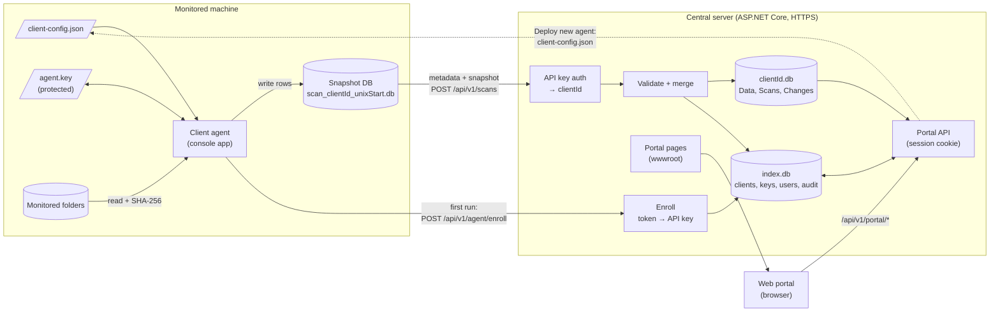

Data flow, end to end:

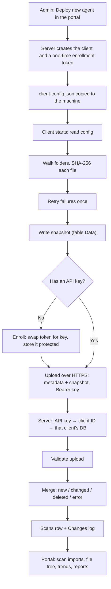

## Deploying an agent

> **Planned.** Specified in [`api-contract.md`](docs/api-contract.md); not built yet.

1. An admin clicks **Deploy new agent** in the portal and enters the computer name, scan interval, and optionally the folders to watch and notes.
2. The server creates the client (status `pending`), assigns its client ID from the computer name, and downloads a ready-to-use `client-config.json`. The file contains a **one-time enrollment token**, valid for 24 hours, instead of a key.
3. Copy the file and the client to the machine. Adjust `directories` there if needed.
4. On its first upload the client swaps the token for its **API key** and stores it protected with Windows DPAPI. The token is now used up, so a copy of the config can't register a second machine.
5. If a machine is rebuilt or its key is lost, an admin issues a **new config** for the same client. **Revoke** stops a client's uploads but keeps its history.

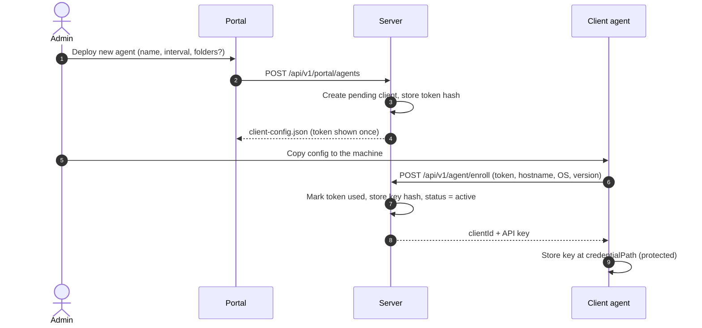

## Client: one scan

The schedule:

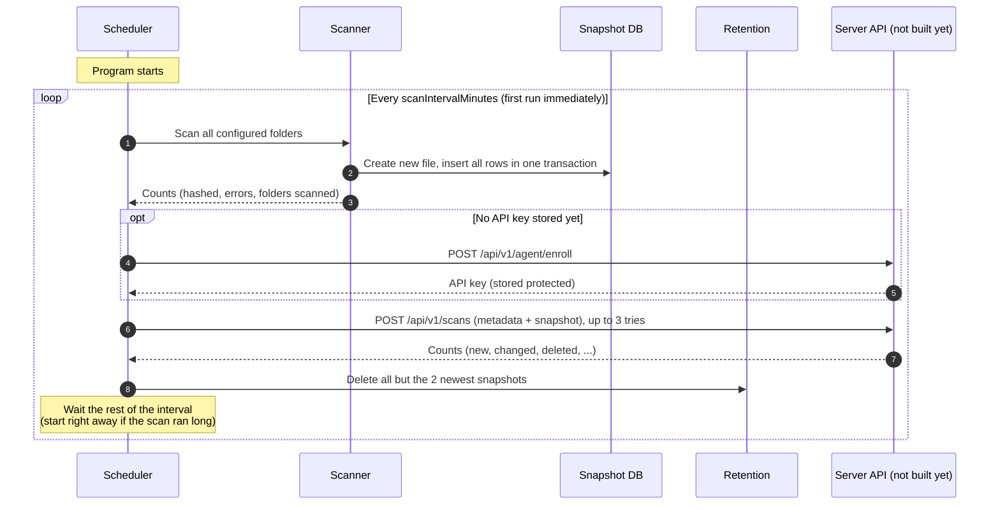

Inside a scan:

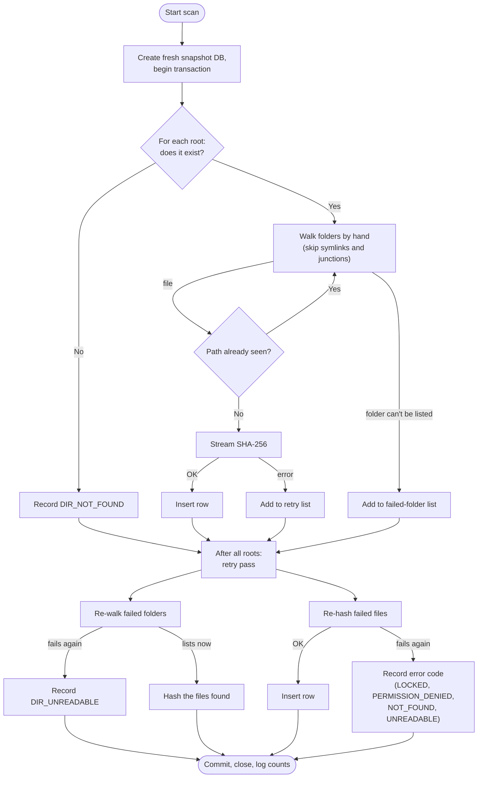

If the scan itself fails (for example, the disk is full), its unfinished DB is deleted so it is never uploaded, and the schedule carries on.

A config as generated by **Deploy new agent** (the committed [`Client/client-config.example.json`](Client/client-config.example.json) still has the older `api` fields until the client's upload is built):

```json
{
  "clientId": "ws-acct-01",
  "scanIntervalMinutes": 5,
  "directories": [ "C:\\Test" ],
  "outputDir": "C:\\FIM\\scans",
  "logPath": "C:\\FIM\\client.log",
  "api": {
    "baseUrl": "https://fileguard.example.edu",
    "enrollmentToken": "fge_9f2c4a7b1e0d3c55_5d1e...c09a",
    "credentialPath": "C:\\FIM\\agent.key",
    "serverKeySha256": "7d1f04c3...e8a2c2a9"
  }
}
```

| Field | Rules |
|---|---|
| `clientId` | Assigned by the server. Used only for local file names and logs; never written to the DB or sent. |
| `scanIntervalMinutes` | Required, > 0. Fractions allowed (0.5 = every 30 seconds). |
| `directories` | Required, at least one (a generated config may start empty; fill it in on the machine). Normalized and de-duplicated on load. |
| `outputDir`, `logPath` | Required. Where snapshots and the log go. Keep them outside the scanned folders. |
| `api.baseUrl` | Required, `https://` only. |
| `api.enrollmentToken` | One-time token, used on first run. Harmless afterwards (used up and expired). |
| `api.credentialPath` | Where the client stores its API key, protected. |
| `api.serverKeySha256` | Optional. Pins the server's public key, so its self-signed certificate is trusted and can be reissued without changing clients. |

## Upload and merge

> **Planned.** The upload and the server are not built yet. This follows [`server-spec.md`](docs/server-spec.md) and [`api-contract.md`](docs/api-contract.md).

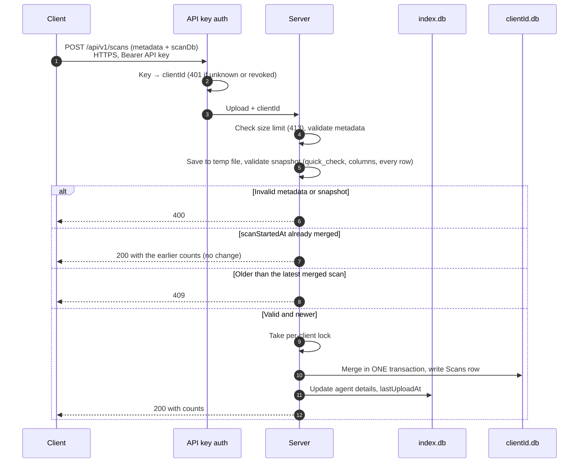

Where each number on the portal's scan table comes from:

| Value | Source |
|---|---|
| Start time, duration, folders scanned | Client, in the upload `metadata` |
| OS, hostname, version, interval, monitored roots | Client, in the upload `metadata` (shown on the client's details) |
| Files found, hashed, failed | Server, counted from the snapshot rows |
| New, changed, deleted, unchanged | Server, from the merge |

How each uploaded row is merged against the client's current (active) rows:

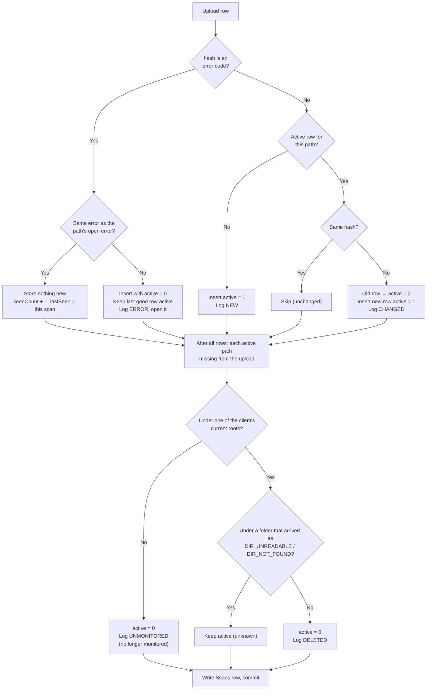

The life of one file path on the server:

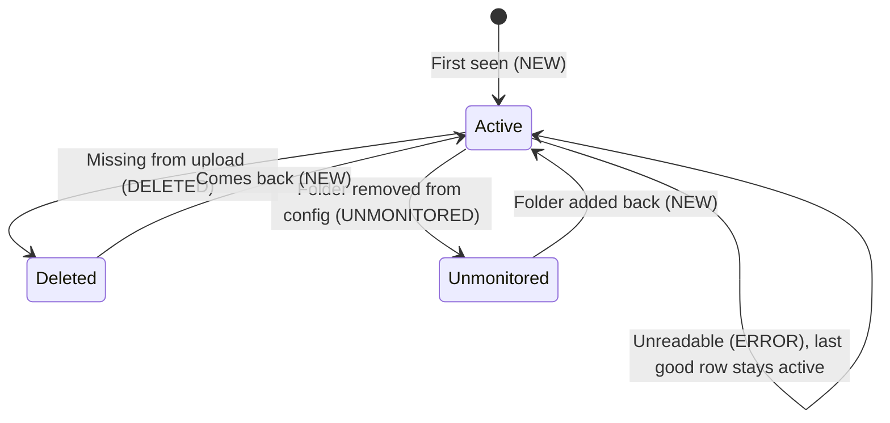

## API

Full spec: [`docs/api-contract.md`](docs/api-contract.md) (v1, proposed 2026-11-11). HTTPS only, JSON bodies, Unix-second times, errors as `application/problem+json` with a `code`.

| Area | Method and route | Auth | Purpose |
|---|---|---|---|
| Agent | `POST /api/v1/agent/enroll` | enrollment token | Swap a one-time token for the API key |
| Agent | `POST /api/v1/scans` | API key | Upload one scan (metadata + snapshot) |
| Login | `POST /api/v1/auth/login`, `POST /logout`, `GET /me` | session | Portal sign-in (cookie + CSRF token) |
| Portal | `GET /api/v1/portal/summary`, `/scans` | viewer | Scan imports tab |
| Portal | `GET /api/v1/portal/clients`, `/clients/{id}`, `/clients/{id}/tree`, `/clients/{id}/file` | viewer | Client files tab |
| Portal | `GET /api/v1/portal/clients/{id}/scans/{scanId}/changes` | viewer | Changes and failures in one scan |
| Portal | `GET /api/v1/portal/trends` | viewer | Trends tab |
| Portal | `POST /api/v1/portal/reports/export`, `/reports/changes.csv` | viewer | HTML report, CSV change list |
| Admin | `POST /api/v1/portal/agents` | admin | Deploy new agent (downloads `client-config.json`) |
| Admin | `POST /clients/{id}/enrollment`, `/clients/{id}/revoke`, `PATCH /clients/{id}` | admin | New config, revoke, edit |
| Admin | `GET/POST /api/v1/portal/users`, `PATCH /users/{name}` | admin | Portal users |

Credentials:

| Credential | Who holds it | Stored on the server as |
|---|---|---|
| Enrollment token `fge_…` | The deployed config file; single use, 24 h | Salted SHA-256 |
| API key `fgk_…` | The agent, at `credentialPath` (DPAPI-encrypted) | Salted SHA-256 |
| Portal password | The user | PBKDF2-SHA256, 600,000 iterations |
| Session cookie `fg_session` | The browser (`HttpOnly`, `Secure`, `SameSite=Strict`) | Server-side session ticket |
| Server HTTPS key | Only the server (`server.pfx`, created by the server on first start) | Clients hold its public-key pin (`serverKeySha256`) |

## Web portal

> **Prototype only.** A clickable static mock-up lives in [`docs/webpage-example/`](docs/webpage-example/) (open `index.html`); see [`web-portal-prototype.md`](docs/web-portal-prototype.md).

| Tab | Shows | Data from |
|---|---|---|
| **Scan imports** | Summary tiles; one row per upload (client, start, duration, folders, found, hashed, failed, new, changed, deleted); expand a row for its failures | `/portal/summary`, `/portal/scans`, `/changes?type=ERROR` |
| **Client files** | Folder tree per client with Changed / New / Deleted / error badges; details for the client, a folder or a file (with full hash history) | `/clients/{id}`, `/tree`, `/file` |
| **Trends** | Line chart of any per-scan measure, per client | `/portal/trends` |
| **Report tray** | Add tables, details and charts; export one HTML file | `/reports/export` |

Admins also get **Deploy new agent** near the top, client actions (new config, revoke, edit) and user management.

## Database design

### Client snapshot (one file per scan)

Shared schema; client, API and server all depend on it. Don't change it without the whole team agreeing.

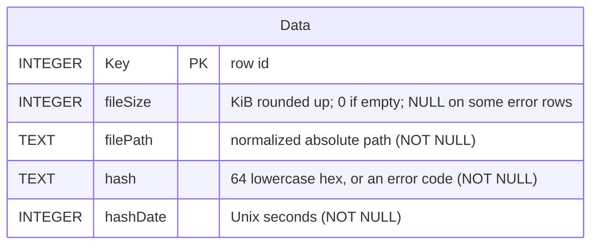

### Upload metadata (one per scan, sent next to the snapshot)

Not a table on the client: a JSON part of the upload. See [`api-contract.md`](docs/api-contract.md).

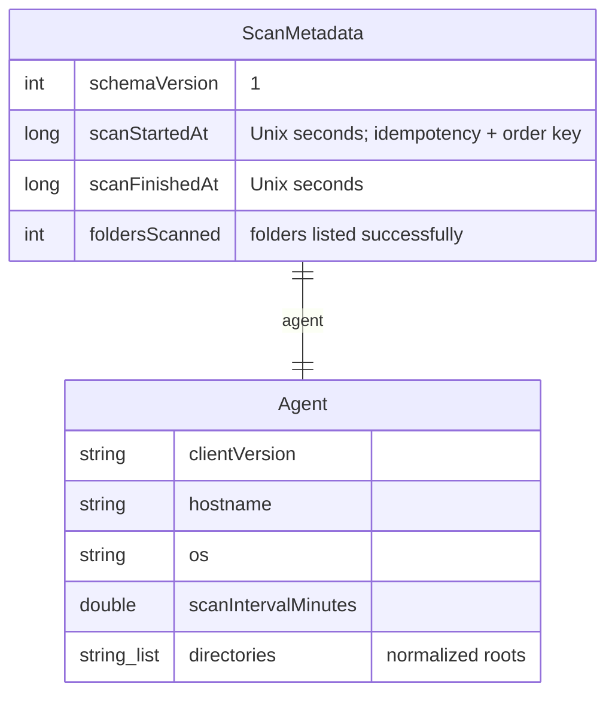

### Server (planned)

`index.db` holds clients, credentials, portal users and the audit log; each client gets its own `<clientId>.db`, created on its first upload.

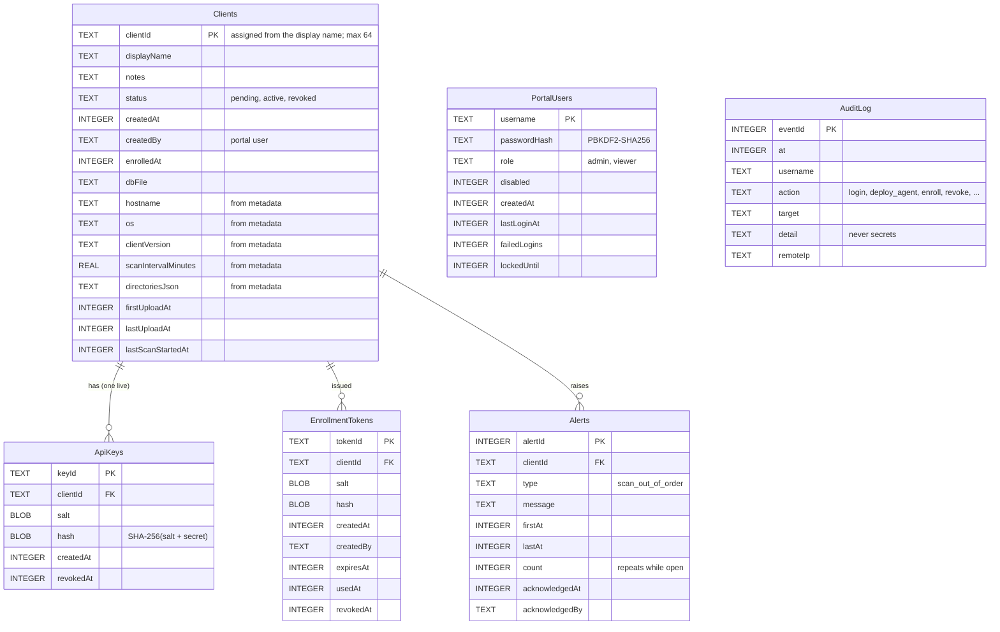

The server also keeps the **2 newest raw uploads** per client as files, `uploads/<clientId>/scan_<scanStartedAt>.db`; older ones are deleted on each upload.

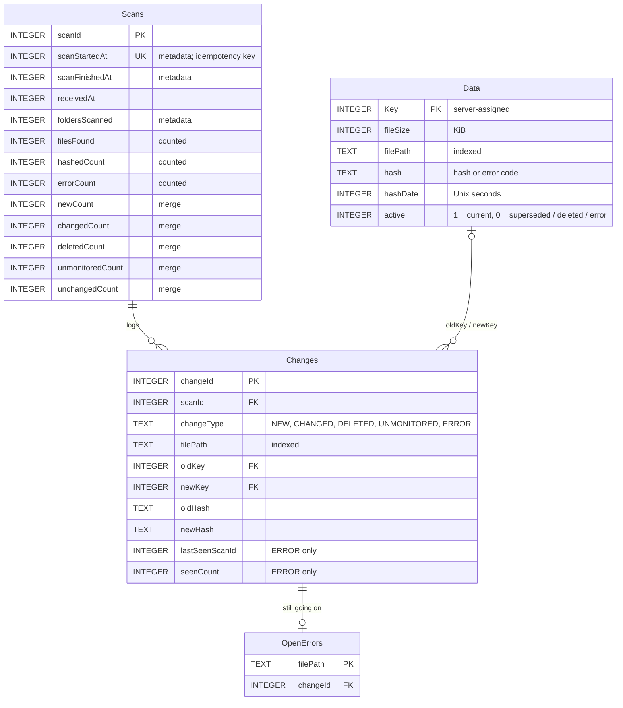

- At most one `active = 1` row per path (unique partial index `IX_Data_ActivePath`).
- Error rows are always stored with `active = 0`, and only when an error **starts or changes**. A repeat of the same error just extends it (`lastSeenScanId`, `seenCount`), the same way unchanged files store nothing. `OpenErrors` lists the errors still going on.
- WAL journal mode, so portal reads don't block upload writes.

## Error codes

Stored in `hash` when a file or folder still can't be read after its retry. Identical on client and server.

| Code | Applies to | Meaning |
|---|---|---|
| `LOCKED` | file | Another process holds a lock |
| `PERMISSION_DENIED` | file | No read access |
| `NOT_FOUND` | file | File vanished mid-scan |
| `UNREADABLE` | file | Any other I/O failure |
| `DIR_UNREADABLE` | folder | Folder couldn't be listed |
| `DIR_NOT_FOUND` | folder | A configured root doesn't exist (e.g. drive unplugged) |

A real hash is always 64 hex characters, so a code can never be mistaken for one.

## Path normalization

So the same file always produces the same string:

1. `Path.GetFullPath` (absolute, resolves `.` and `..`)
2. Replace `\` with `/`
3. Trim a trailing separator, except for a bare root like `C:/`
4. On Windows, lowercase. On Linux/macOS, keep the casing.

Example: `C:\Test\Sub\..\Report.TXT` → `c:/test/report.txt`

## Getting started

Requires the **.NET 10 SDK**. Full setup checklist: [`docs/dev-setup.md`](docs/dev-setup.md).

```sh
dotnet build          # must finish with 0 warnings, 0 errors
dotnet test
dotnet format         # run before every push
```

Run the client:

1. Copy `Client/client-config.example.json` to `Client/client-config.json` (gitignored) and edit the folders.
2. `dotnet run --project Client -- Client/client-config.json`, or press **F5** with the **Client** launch config.
3. Press **Ctrl+C** to stop.

To run on a machine without the SDK, publish a self-contained build and copy the folder over:

```sh
dotnet publish Client -c Release -r win-x64 --self-contained
```

## Repository layout

```
Integrity.slnx               solution
global.json                  pinned .NET SDK
Directory.Build.props        shared build settings (warnings are errors)
Directory.Packages.props     central NuGet versions
Client/                      console client
  Program.cs                 entry point, Ctrl+C handling
  ClientConfig.cs            load + validate config
  ScanScheduler.cs           startup scan + interval loop
  Scanner.cs                 folder walk, hashing, retry pass
  ScanDatabase.cs            snapshot DB (table Data)
  SnapshotRetention.cs       keep the 2 newest snapshots
  FileHasher.cs              streamed SHA-256, KiB rounding
  HashError.cs               shared error codes
  PathNormalizer.cs          path normalization
  FileLogger.cs              console + file log
Server/                      ASP.NET Core server (template only so far)
Tests/                       xUnit tests
docs/                        specification
```

## Project status

> Keep these three sections current. When a feature is built, move it from **To do** to **Done**. When a question is answered, remove it from **Open questions** (and from [`docs/open-questions.md`](docs/open-questions.md)) and record the decision in the matching spec.

### Done

- **Repo setup:** .NET 10 solution with `Client`, `Server`, `Tests`; pinned SDK; shared build settings with warnings as errors; central package versions; `.editorconfig`, `.gitattributes`; VS Code extensions, settings, tasks and launch configs.
- **Client config:** loading and validation; folders normalized and de-duplicated.
- **Client schedule:** scan at startup, then every `scanIntervalMinutes` from the start of each scan; a failed run is logged and the schedule continues; clean stop on Ctrl+C.
- **Client scan:** hand-written folder walk that skips symlinks and junctions; streamed SHA-256; KiB sizes; overlapping folders hashed once; one retry pass for files and folders; all six error codes.
- **Client snapshot DB:** fresh file per scan in one transaction; unfinished DB deleted on failure.
- **Client retention:** only the 2 newest snapshots are kept.
- **Client logging:** console plus log file.
- **Tests:** 39 xUnit tests covering config, path normalization, hashing, error mapping, scanning, and retention.
- **Docs:** full specification in `docs/`, plus this README.
- **API spec v1:** agent enrollment and API keys, scan upload with metadata, portal login and roles, portal data and admin endpoints ([`api-contract.md`](docs/api-contract.md)).
- **Portal prototype:** clickable static mock-up of the login page and the three tabs, with placeholder data ([`web-portal-prototype.md`](docs/web-portal-prototype.md)).

### To do

**Client** (to match the updated spec)
- New `api` config fields (`enrollmentToken`, `credentialPath`, `serverKeySha256`) and validation: `clientId` must match `^[A-Za-z0-9._-]{1,64}$`, `baseUrl` must be HTTPS. Update `client-config.example.json`.
- Count `foldersScanned` and record `scanFinishedAt`.
- Enrollment: swap the token for an API key; store it with DPAPI (needs the `System.Security.Cryptography.ProtectedData` package, added through a team PR).
- Upload: multipart `metadata` + `scanDb`, Bearer key, public-key pinning, 3 attempts (5 s, 30 s), no retry on 4xx.
- Phase 1: run from the IDE on a Windows test client machine against a test server.
- Phase 2: publish an executable and install it as a Windows Service (`Microsoft.Extensions.Hosting.WindowsServices`, through a team PR) so it starts with the machine.
- Log a 409 as a likely clock problem.

**Secure API** (teammates, per [`api-contract.md`](docs/api-contract.md))
- API key authentication handler, enrollment endpoint, credential hashing.
- Portal login: cookie sessions, CSRF, lockout, PBKDF2 passwords, `admin` / `viewer` roles, first admin from `FIM_ADMIN_PASSWORD`.
- Rate limits, problem+json errors, HSTS.

**Server**
- `index.db` (`Clients`, `ApiKeys`, `EnrollmentTokens`, `PortalUsers`, `AuditLog`, `Alerts`) and per-client DBs (`Data`, `Scans`, `Changes`, `OpenErrors`), WAL mode.
- Upload endpoint: metadata validation, temp file, size limit, snapshot validation, per-client lock; keep the 2 newest raw uploads per client.
- Merge in one transaction: NEW / CHANGED / DELETED / UNMONITORED / ERROR (errors stored once, repeats counted), idempotent and ordered; `Scans` row with metadata, counts and merge totals.
- Out-of-order scans: 409, warning in `server.log`, `scan_out_of_order` alert.
- Portal data endpoints: summary, scans, clients, tree, file, files, changes, trends, alerts.
- Reports: HTML export of the report tray, CSV change list.
- Admin endpoints: Deploy new agent (config generation), new enrollment, revoke, edit client, users.
- HTTPS certificate: create the key and self-signed certificate on first start, reissue with the same key when the names change or expiry is near, log the key pin.
- `Server/server-config.example.json`.

**Web portal**
- Turn the prototype into real pages (plain JavaScript) under `Server/wwwroot`, calling the API.
- Add Deploy new agent, client actions, alert acknowledgement and user management (admins only).
- Alerts indicator, UTC / local time toggle, "No longer monitored" badge.

**Team**
- API teammates review and confirm [`api-contract.md`](docs/api-contract.md) v1.

**Tooling**
- Optional: GitHub Actions workflow running `dotnet build` and `dotnet test` on every pull request.

**Ideas for later** (not planned yet; see [`potential-features.md`](docs/potential-features.md))
- Warn about or skip configured folders that contain the client's own files (`outputDir`, log, app folder).

### Open questions

Full list: [`docs/open-questions.md`](docs/open-questions.md).

**To confirm** (proposed in API spec v1): API keys rather than certificates; enrollment tokens; whole-file upload with metadata (max 500 MiB); upload retry policy; `admin`/`viewer` roles where everyone sees every client; HTML + CSV exports, never stored.

Nothing else is open right now.

## Documentation

| File | What's in it |
|---|---|
| [`docs/overview.md`](docs/overview.md) | Purpose, parts, data flow, core decisions, glossary |
| [`docs/data-model.md`](docs/data-model.md) | Shared `Data` table, error codes, path normalization |
| [`docs/client-spec.md`](docs/client-spec.md) | Client config, enrollment, schedule, scan, upload, retention |
| [`docs/client-pseudocode.md`](docs/client-pseudocode.md) | Client pseudocode |
| [`docs/server-spec.md`](docs/server-spec.md) | Server storage, agent deployment, upload handling, merge rule, portal |
| [`docs/server-pseudocode.md`](docs/server-pseudocode.md) | Server pseudocode |
| [`docs/api-contract.md`](docs/api-contract.md) | API spec v1: every route, payload, status code and credential |
| [`docs/web-portal-prototype.md`](docs/web-portal-prototype.md) | Portal prototype: pages, features, placeholder data |
| [`docs/dev-setup.md`](docs/dev-setup.md) | Team setup checklist |
| [`docs/open-questions.md`](docs/open-questions.md) | Undecided items |
| [`docs/potential-features.md`](docs/potential-features.md) | Ideas for later |
| [`CLAUDE.md`](CLAUDE.md) | Instructions for Claude Code |
