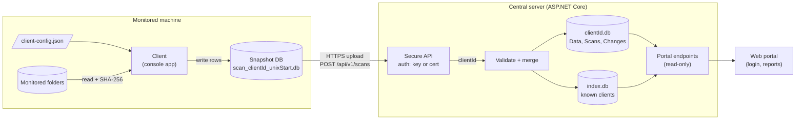
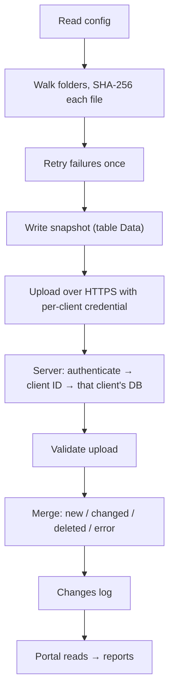
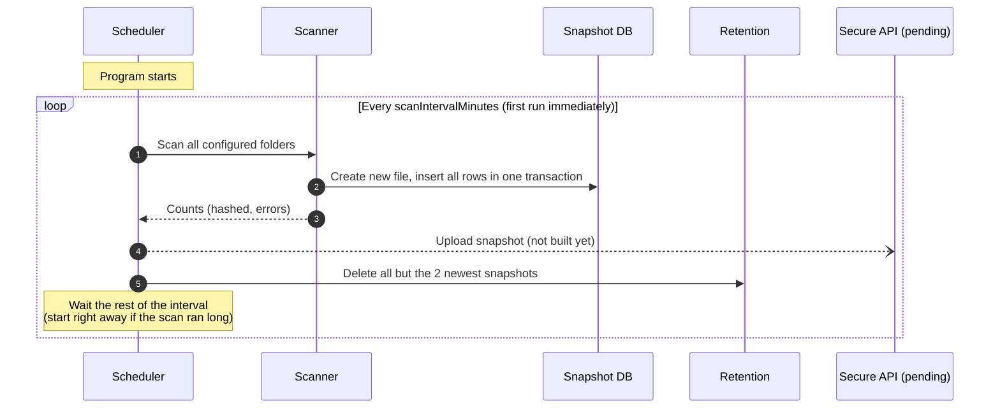
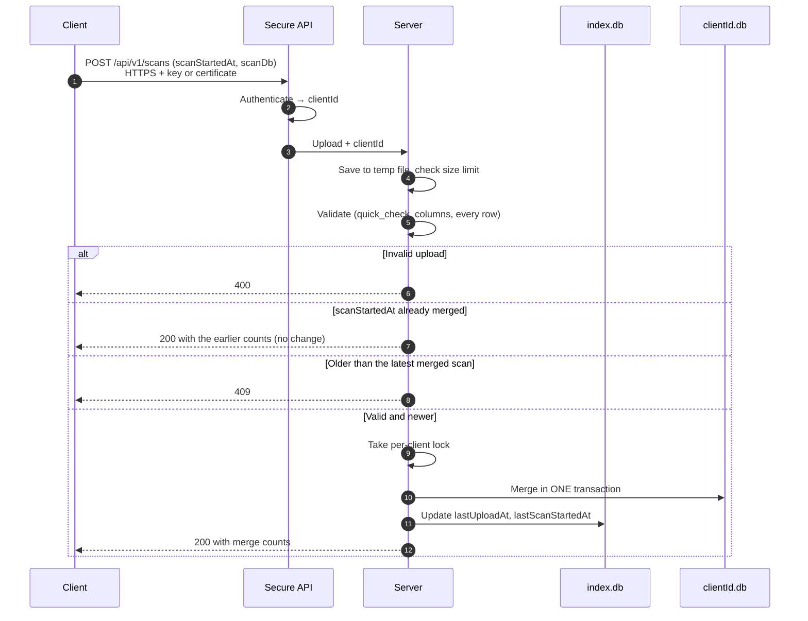
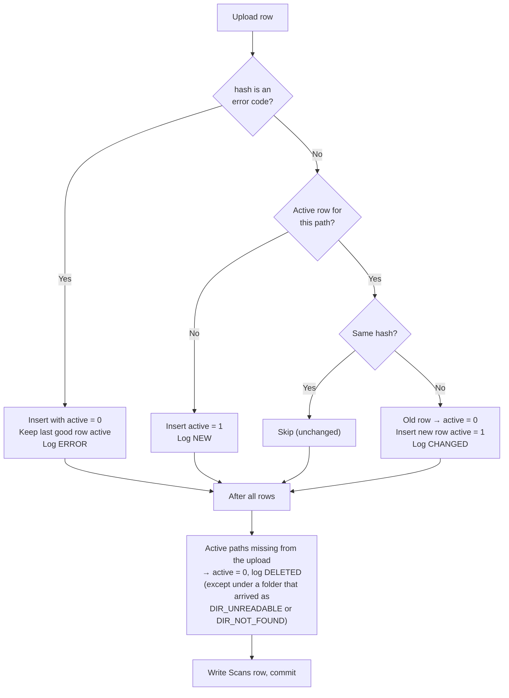
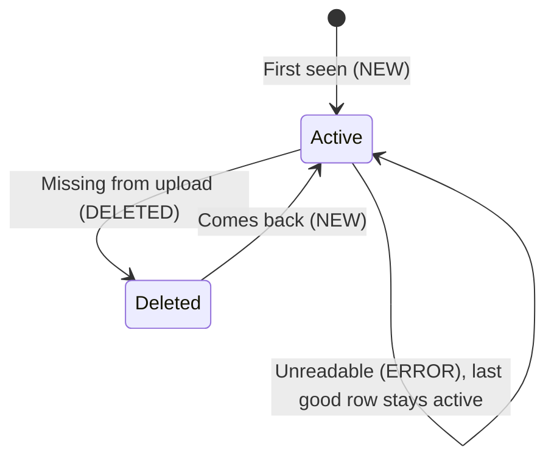
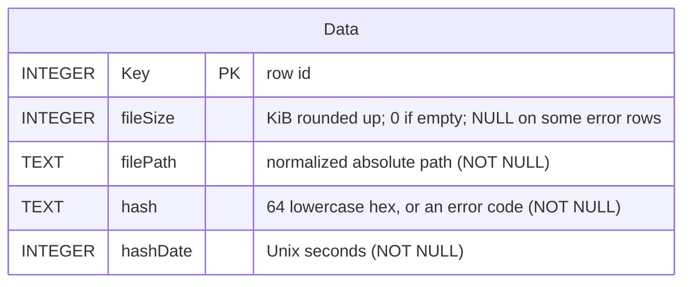
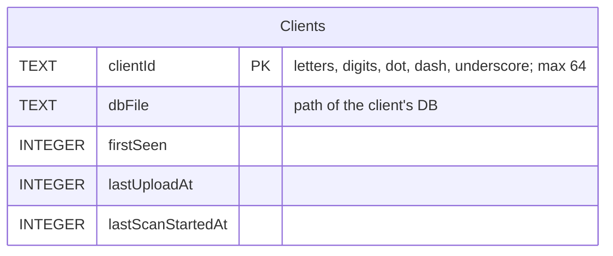
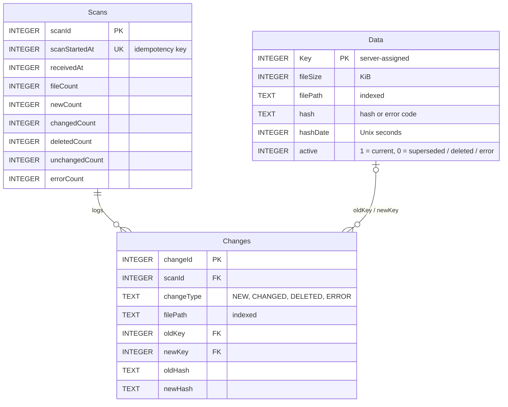

# File Integrity Monitor

A senior design project that detects files that have been **tampered with or corrupted**.

A **client** runs on each monitored machine. It fingerprints every file in its configured folders with SHA-256 and saves the results to a small SQLite snapshot. The snapshot is uploaded to a **central server**, which keeps one database per client, compares each upload with the last one, and records which files are **new**, **changed**, **deleted**, or **unreadable**. A **web portal** hosted by the server shows the results as reports.

If even one byte of a file changes, its SHA-256 fingerprint changes, so comparing fingerprints over time shows exactly which files were touched.

> The full specification lives in [`docs/`](docs/). This README is the overview; when the two disagree, `docs/` wins.

## Contents

- [How it works](#how-it-works)
- [Architecture](#architecture)
- [Client: one scan](#client-one-scan)
- [Upload and merge](#upload-and-merge)
- [Database design](#database-design)
- [Error codes](#error-codes)
- [Path normalization](#path-normalization)
- [Getting started](#getting-started)
- [Repository layout](#repository-layout)
- [Project status](#project-status)
  - [Done](#done)
  - [To do](#to-do)
  - [Open questions](#open-questions)
- [Documentation](#documentation)

## How it works

| Part | What it does | Owner |
|---|---|---|
| **Client** | Runs on each monitored machine. Reads a config file, hashes files recursively, writes a local SQLite snapshot, uploads it. | Sam |
| **Secure API** | HTTPS transport and per-client authentication (key or certificate) between client and server. | Teammates |
| **Server** | Receives uploads, keeps one SQLite DB per client, merges each upload, serves data and reports. | Sam |
| **Web portal** | Login and report generation, hosted by the server. UI/UX still pending. | Team (pending) |

Key decisions:

- The client sends a **fresh full snapshot** every scan. The client never diffs; the server does all comparison.
- The client scans **once at startup** and then every `scanIntervalMinutes`, timed from the start of each scan so the schedule doesn't drift.
- Files and folders that can't be read are **retried once** after the full scan, then recorded with a fixed [error code](#error-codes) instead of a hash. One bad file never stops a scan.
- The client keeps **at most 2 local snapshots**. The server does long-term storage.
- The snapshot has **no client ID column**. The server learns who is sending from the client's credential, never from the uploaded data.
- The server keeps **one SQLite DB per client**, and its DBs change **only when an upload arrives**. The portal only reads.
- **History is never deleted.** A changed file gets a new row, and the old row is marked inactive.
- **HTTPS only**, with a per-client key or certificate.

## Architecture



Data flow, end to end:



## Client: one scan

The schedule:



Inside a scan:


If the scan itself fails (for example, the disk is full), its unfinished DB is deleted so it is never uploaded, and the schedule carries on.

Example config ([`Client/client-config.example.json`](Client/client-config.example.json)):

```json
{
  "clientId": "demo-pc",
  "scanIntervalMinutes": 5,
  "directories": [ "C:\\Test" ],
  "outputDir": "C:\\FIM\\scans",
  "logPath": "C:\\FIM\\client.log",
  "api": {
    "baseUrl": "https://fim-server.example.edu",
    "clientCertPath": "C:\\FIM\\client.pfx",
    "apiKeyEnvVar": "FIM_API_KEY"
  }
}
```

| Field | Rules |
|---|---|
| `clientId` | Required. Used only for local file names and logs; never written to the DB or sent. |
| `scanIntervalMinutes` | Required, > 0. Fractions allowed (0.5 = every 30 seconds). |
| `directories` | Required, at least one. Normalized and de-duplicated on load. |
| `outputDir`, `logPath` | Required. Where snapshots and the log go. Keep them outside the scanned folders. |
| `api` | Required. Placeholder fields until the API team defines them. Secrets come from env vars, never the file. |

## Upload and merge

> **Planned.** The upload and the server are not built yet. This follows [`server-spec.md`](docs/server-spec.md) and [`api-contract.md`](docs/api-contract.md); routes and auth are placeholders owned by the API team.



How each uploaded row is merged against the client's current (active) rows:



The life of one file path on the server:



## Database design

### Client snapshot (one file per scan)

Shared schema; client, API and server all depend on it. Don't change it without the whole team agreeing.



### Server (planned)

`index.db` lists known clients, and each client gets its own `<clientId>.db`.





- At most one `active = 1` row per path (unique partial index `IX_Data_ActivePath`).
- Error rows are always stored with `active = 0`.
- WAL journal mode, so portal reads don't block upload writes.

## Error codes

Stored in `hash` when a file or folder still can't be read after its retry. Identical on client and server.

| Code | Applies to | Meaning |
|---|---|---|
| `LOCKED` | file | Another process holds a lock |
| `PERMISSION_DENIED` | file | No read access |
| `NOT_FOUND` | file | File vanished mid-scan |
| `UNREADABLE` | file | Any other I/O failure |
| `DIR_UNREADABLE` | folder | Folder couldn't be listed |
| `DIR_NOT_FOUND` | folder | A configured root doesn't exist (e.g. drive unplugged) |

A real hash is always 64 hex characters, so a code can never be mistaken for one.

## Path normalization

So the same file always produces the same string:

1. `Path.GetFullPath` (absolute, resolves `.` and `..`)
2. Replace `\` with `/`
3. Trim a trailing separator, except for a bare root like `C:/`
4. On Windows, lowercase. On Linux/macOS, keep the casing.

Example: `C:\Test\Sub\..\Report.TXT` → `c:/test/report.txt`

## Getting started

Requires the **.NET 10 SDK**. Full setup checklist: [`docs/dev-setup.md`](docs/dev-setup.md).

```sh
dotnet build          # must finish with 0 warnings, 0 errors
dotnet test
dotnet format         # run before every push
```

Run the client:

1. Copy `Client/client-config.example.json` to `Client/client-config.json` (gitignored) and edit the folders.
2. `dotnet run --project Client -- Client/client-config.json`, or press **F5** with the **Client** launch config.
3. Press **Ctrl+C** to stop.

To run on a machine without the SDK, publish a self-contained build and copy the folder over:

```sh
dotnet publish Client -c Release -r win-x64 --self-contained
```

## Repository layout

```
Integrity.slnx               solution
global.json                  pinned .NET SDK
Directory.Build.props        shared build settings (warnings are errors)
Directory.Packages.props     central NuGet versions
Client/                      console client
  Program.cs                 entry point, Ctrl+C handling
  ClientConfig.cs            load + validate config
  ScanScheduler.cs           startup scan + interval loop
  Scanner.cs                 folder walk, hashing, retry pass
  ScanDatabase.cs            snapshot DB (table Data)
  SnapshotRetention.cs       keep the 2 newest snapshots
  FileHasher.cs              streamed SHA-256, KiB rounding
  HashError.cs               shared error codes
  PathNormalizer.cs          path normalization
  FileLogger.cs              console + file log
Server/                      ASP.NET Core server (template only so far)
Tests/                       xUnit tests
docs/                        specification
```

## Project status

> Keep these three sections current. When a feature is built, move it from **To do** to **Done**. When a question is answered, remove it from **Open questions** (and from [`docs/open-questions.md`](docs/open-questions.md)) and record the decision in the matching spec.

### Done

- **Repo setup:** .NET 10 solution with `Client`, `Server`, `Tests`; pinned SDK; shared build settings with warnings as errors; central package versions; `.editorconfig`, `.gitattributes`; VS Code extensions, settings, tasks and launch configs.
- **Client config:** loading and validation; folders normalized and de-duplicated.
- **Client schedule:** scan at startup, then every `scanIntervalMinutes` from the start of each scan; a failed run is logged and the schedule continues; clean stop on Ctrl+C.
- **Client scan:** hand-written folder walk that skips symlinks and junctions; streamed SHA-256; KiB sizes; overlapping folders hashed once; one retry pass for files and folders; all six error codes.
- **Client snapshot DB:** fresh file per scan in one transaction; unfinished DB deleted on failure.
- **Client retention:** only the 2 newest snapshots are kept.
- **Client logging:** console plus log file.
- **Tests:** 39 xUnit tests covering config, path normalization, hashing, error mapping, scanning, and retention.
- **Docs:** full specification in `docs/`, plus this README.

### To do

**Client**
- Upload the snapshot to the server (waiting on the secure API; see [`api-contract.md`](docs/api-contract.md)).
- Retry uploads with backoff on network errors, timeouts and 5xx only; refuse a non-HTTPS base URL.
- Run as a Windows Service / systemd service so it starts with the machine.

**Secure API** (teammates)
- HTTPS transport and per-client key or certificate auth.
- Tell the server which client is sending (claim `clientId`); portal login policy.

**Server**
- Per-client DBs and `index.db`, with `Data`, `Scans`, `Changes` tables and WAL mode.
- Upload endpoint: temp file, size limit, validation, per-client lock.
- Merge in one transaction: NEW / CHANGED / DELETED / ERROR, idempotent and ordered.
- Read-only portal endpoints and report generation (JSON / CSV).

**Web portal** (team)
- Design the UI/UX, then build login and reports.

**Tooling**
- Optional: GitHub Actions workflow running `dotnet build` and `dotnet test` on every pull request.

**Ideas for later** (not planned yet; see [`potential-features.md`](docs/potential-features.md))
- Warn about or skip configured folders that contain the client's own files (`outputDir`, log, app folder).

### Open questions

Full list: [`docs/open-questions.md`](docs/open-questions.md).

**Portal**
- What the UI/UX looks like and which reports are needed.
- Should some portal users see only some clients?
- Report history, size limits, or streaming large reports.

**API**
- Key vs. certificate, header names, and upload format (whole DB file vs. JSON rows).
- Who issues per-client credentials, and whether an unknown but authenticated client gets a DB automatically (current: yes).
- Upload retry policy and maximum upload size (placeholder 500 MB).

**Server**
- Keep raw uploaded DB files for an audit trail, or delete after merge (current: delete).
- Confirm that out-of-order uploads are rejected with 409.
- Whether the portal needs "deleted" vs. "superseded" without reading the `Changes` log (would need another column).
- How short scan intervals affect DB growth for large clients.

## Documentation

| File | What's in it |
|---|---|
| [`docs/overview.md`](docs/overview.md) | Purpose, parts, data flow, core decisions, glossary |
| [`docs/data-model.md`](docs/data-model.md) | Shared `Data` table, error codes, path normalization |
| [`docs/client-spec.md`](docs/client-spec.md) | Client config, schedule, scan, retention, upload |
| [`docs/client-pseudocode.md`](docs/client-pseudocode.md) | Client pseudocode |
| [`docs/server-spec.md`](docs/server-spec.md) | Server storage, upload handling, merge rule, portal endpoints |
| [`docs/server-pseudocode.md`](docs/server-pseudocode.md) | Server pseudocode |
| [`docs/api-contract.md`](docs/api-contract.md) | Client ↔ server contract (placeholders) |
| [`docs/dev-setup.md`](docs/dev-setup.md) | Team setup checklist |
| [`docs/open-questions.md`](docs/open-questions.md) | Undecided items |
| [`docs/potential-features.md`](docs/potential-features.md) | Ideas for later |
| [`CLAUDE.md`](CLAUDE.md) | Instructions for Claude Code |
