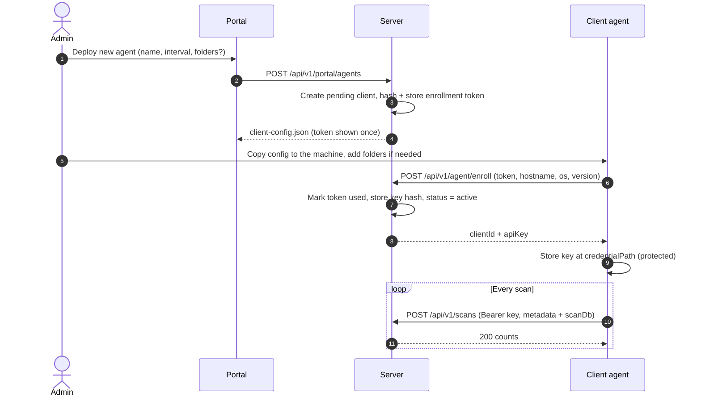

# API Specification (v1)

The HTTPS API between the client agents, the server and the web portal.

**Status: proposed v1 (Sam, 2026-11-11).** The secure API is implemented by teammates; this spec is what client, server and portal code are written against. Changes to it (routes, fields, auth) need the whole team's agreement, like the shared `Data` schema.

## Overview

| Caller | Authenticates with | Base path |
|---|---|---|
| Client agent | Per-client **API key** (Bearer header). Before it has one, a one-time **enrollment token**. | `/api/v1/agent`, `/api/v1/scans` |
| Web portal (browser) | Username + password → **session cookie** | `/api/v1/auth`, `/api/v1/portal` |

- **HTTPS only.** The server never listens on plain HTTP and sends HSTS. The client refuses a non-HTTPS base URL.
- **The portal is served by the same server** (static files), so there is no CORS.
- **Client identity comes only from the API key.** No request carries a client ID that the server trusts; the key decides which client DB is written.
- **Keys, tokens and passwords** are never logged, never committed, and stored on the server only as salted hashes.
- All times are **Unix seconds (UTC)**; the portal converts them for display (UTC or the viewer's local time zone, by a toggle). All bodies are JSON (UTF-8) unless stated.
- Breaking changes go to `/api/v2`. Adding optional fields is not breaking; clients and the server ignore unknown JSON fields.

### Endpoint summary

| Method | Route | Auth | Purpose |
|---|---|---|---|
| POST | `/api/v1/agent/enroll` | enrollment token | Swap a one-time token for the client's API key |
| POST | `/api/v1/scans` | API key | Upload one scan (metadata + snapshot DB) |
| POST | `/api/v1/auth/login` | none | Portal login, sets the session cookie |
| POST | `/api/v1/auth/logout` | session | End the session |
| GET | `/api/v1/auth/me` | session | Current user and role, plus a CSRF token |
| GET | `/api/v1/portal/summary` | viewer | Summary tiles (latest scan per client) |
| GET | `/api/v1/portal/scans` | viewer | Scan imports table, all or one client |
| GET | `/api/v1/portal/clients` | viewer | Client list |
| GET | `/api/v1/portal/clients/{clientId}` | viewer | One client's details |
| GET | `/api/v1/portal/clients/{clientId}/scans/{scanId}/changes` | viewer | Changes (and failures) in one scan |
| GET | `/api/v1/portal/clients/{clientId}/tree` | viewer | One level of the folder tree |
| GET | `/api/v1/portal/clients/{clientId}/file` | viewer | One file's details and full hash history |
| GET | `/api/v1/portal/clients/{clientId}/files` | viewer | Flat file listing (active, optionally all rows) |
| GET | `/api/v1/portal/trends` | viewer | Per-scan series for the trends chart |
| GET | `/api/v1/portal/alerts` | viewer | Alerts (e.g. rejected out-of-order scans) |
| POST | `/api/v1/portal/alerts/{alertId}/acknowledge` | admin | Acknowledge an alert |
| POST | `/api/v1/portal/reports/export` | viewer | Export the report tray as an HTML file |
| POST | `/api/v1/portal/reports/changes.csv` | viewer | Change list as CSV |
| POST | `/api/v1/portal/agents` | admin | **Deploy new agent**: create a client, download its config |
| POST | `/api/v1/portal/clients/{clientId}/enrollment` | admin | New config (new enrollment token) for an existing client |
| POST | `/api/v1/portal/clients/{clientId}/revoke` | admin | Revoke the client's API key |
| PATCH | `/api/v1/portal/clients/{clientId}` | admin | Edit display name / notes |
| GET | `/api/v1/portal/users` | admin | List portal users |
| POST | `/api/v1/portal/users` | admin | Create a portal user |
| PATCH | `/api/v1/portal/users/{username}` | admin | Change role, reset password, disable |

## Conventions

### Errors

Every error response is `application/problem+json` ([RFC 9457](https://www.rfc-editor.org/rfc/rfc9457)) with a machine-readable `code`:

```json
{
  "type": "about:blank",
  "title": "Scan out of order",
  "status": 409,
  "code": "scan_out_of_order",
  "detail": "A scan started at 1793222400 or later was already merged for this client."
}
```

| Status | `code` values | Meaning |
|---|---|---|
| 400 | `invalid_request`, `invalid_metadata`, `invalid_upload` | Malformed body, failed validation, corrupt or non-conforming snapshot |
| 401 | `unauthorized`, `enrollment_invalid`, `login_failed` | Missing/unknown/revoked key, bad/expired/used token, wrong username or password |
| 403 | `forbidden`, `csrf_failed` | Authenticated but not allowed (e.g. viewer on an admin route); missing CSRF token |
| 404 | `not_found` | Unknown client, scan, path or user |
| 409 | `scan_out_of_order`, `conflict` | Older scan than one already merged; duplicate username |
| 413 | `upload_too_large` | Upload over `maxUploadBytes` |
| 423 | `account_locked` | Too many failed logins; try again later |
| 429 | `rate_limited` | Too many requests (enroll, login); `Retry-After` header set |
| 500 / 503 | `server_error`, `unavailable` | Server fault; safe to retry later |

Error messages never reveal whether a key, token or username exists.

### Paging

List endpoints take `page` (1-based, default 1) and `pageSize` (default 100, max 1000) and return:

```json
{ "items": [ ... ], "page": 1, "pageSize": 100, "totalCount": 2345 }
```

### Credential formats

| Credential | Format | Lifetime |
|---|---|---|
| API key | `fgk_<keyId>_<secret>`: `keyId` = 16 hex chars, `secret` = 64 hex chars (32 random bytes) | Until revoked or replaced by re-enrollment |
| Enrollment token | `fge_<tokenId>_<secret>`, same shape | Single use; expires after `enrollmentTokenHours` (default 24) |

The prefix makes leaked credentials easy to spot. The server stores `keyId`/`tokenId`, a random 16-byte salt and `SHA-256(salt ‖ secret)`, looks the record up by id and compares hashes in constant time. A plain-text key or token exists only in the one response that hands it out.

## Agent API

### `POST /api/v1/agent/enroll`

Swaps a one-time enrollment token (from a deployed config file) for the client's API key. Called by the client when it has no stored key yet. Rate-limited to 10 requests per minute per IP.

Request:

```json
{
  "enrollmentToken": "fge_9f2c4a7b1e0d3c55_5d1e...c09a",
  "hostname": "WS-ACCT-01",
  "os": "Microsoft Windows 10.0.26200",
  "clientVersion": "1.0.0"
}
```

`200 OK`:

```json
{ "clientId": "ws-acct-01", "apiKey": "fgk_3b8e0f12aa94c7d1_77c4...e21b" }
```

Effects (one transaction): the token is marked used, any earlier key of this client is revoked, a new key is stored (hashed), and the client's status becomes `active`.

| Status | When | Client action |
|---|---|---|
| 200 | Enrolled | Store the key (see `client-spec.md`), continue |
| 400 `invalid_request` | Missing fields | Log; don't retry |
| 401 `enrollment_invalid` | Unknown, expired, already used, or the client was revoked | Log "deploy a new config"; don't retry with this token |
| 429 / 5xx / network | Transient | Try again before the next upload |

If the 200 response is lost in transit, the token is already used: an admin issues a new config (`POST /clients/{clientId}/enrollment`).

### `POST /api/v1/scans`

Uploads one scan. `Authorization: Bearer <apiKey>`. `Content-Type: multipart/form-data` with two parts:

| Part | Content type | Content |
|---|---|---|
| `metadata` | `application/json` | Scan metadata, below |
| `scanDb` | `application/vnd.sqlite3` | The snapshot file (table `Data`, see `data-model.md`) |

Metadata (`schemaVersion` 1):

```json
{
  "schemaVersion": 1,
  "scanStartedAt": 1793222289,
  "scanFinishedAt": 1793222361,
  "foldersScanned": 3,
  "agent": {
    "clientVersion": "1.0.0",
    "hostname": "WS-ACCT-01",
    "os": "Microsoft Windows 10.0.26200",
    "scanIntervalMinutes": 360,
    "directories": [ "c:/fileguard-watch/finance", "c:/fileguard-watch/hr" ]
  }
}
```

| Field | Rules |
|---|---|
| `schemaVersion` | `1` |
| `scanStartedAt` | Unix seconds when the scan started. Also the server's idempotency key and order key. |
| `scanFinishedAt` | Unix seconds when the snapshot was committed. ≥ `scanStartedAt`. Duration = difference. |
| `foldersScanned` | Folders the client listed successfully (roots and subfolders), ≥ 0 |
| `agent.clientVersion` | Client build version, ≤ 32 chars |
| `agent.hostname` | `Environment.MachineName`, ≤ 255 chars |
| `agent.os` | `RuntimeInformation.OSDescription`, ≤ 255 chars |
| `agent.scanIntervalMinutes` | The interval in the client's config, > 0 |
| `agent.directories` | The client's configured roots, **normalized** (see `data-model.md`), 1 to 1000 entries |

**Only facts the server can't derive are sent.** Files found, hashed and failed are counted from the snapshot rows; new, changed, deleted and unchanged come from the merge. The client never diffs.

`200 OK` (also returned, with `alreadyMerged: true` and the original counts, when the same `scanStartedAt` arrives again):

```json
{
  "scanId": 42,
  "alreadyMerged": false,
  "counts": {
    "filesFound": 1204, "hashed": 1201, "errors": 4,
    "new": 2, "changed": 1, "deleted": 0, "unmonitored": 0, "unchanged": 1198
  }
}
```

| Status | When | Client action |
|---|---|---|
| 200 | Merged, or already merged | Done |
| 400 `invalid_metadata` / `invalid_upload` | Bad metadata or a corrupt / non-conforming snapshot | Log; don't retry |
| 401 `unauthorized` | Key missing, unknown or revoked | Log "credential rejected, deploy a new config"; don't retry |
| 409 `scan_out_of_order` | An equal-or-newer scan was already merged (usually the client's clock went backwards). The server also logs it and raises a portal alert. | Log as an error that mentions the clock; don't retry |
| 413 `upload_too_large` | Over `maxUploadBytes` (default 500 MiB) | Log; don't retry |
| 5xx, timeout, network error | Transient | Retry |

**Client retry policy:** at most 3 attempts per scan, waiting 5 s then 30 s (no wait after the last). Each attempt times out after 10 minutes. Only network errors, timeouts and 5xx are retried. A scan that ultimately fails is never re-sent; the next scan uploads newer data.

## Portal authentication

### `POST /api/v1/auth/login`

```json
{ "username": "sam", "password": "correct horse battery staple" }
```

`200 OK` sets the session cookie and returns `{ "username": "sam", "role": "admin", "csrfToken": "..." }`. Wrong username or password: `401 login_failed` (same message either way). After 5 failed attempts in a row the account is locked for 15 minutes (`423 account_locked`). Login is also rate-limited per IP.

- **Session cookie** `fg_session`: `HttpOnly`, `Secure`, `SameSite=Strict`, path `/`. Expires after 30 minutes idle or 8 hours total.
- **CSRF:** every `POST`, `PATCH` and `DELETE` from the portal sends the token from login or `/auth/me` in an `X-CSRF-TOKEN` header (ASP.NET Core antiforgery). Missing or wrong → `403 csrf_failed`.
- **Passwords:** at least 12 characters; stored as PBKDF2-HMAC-SHA256, 600,000 iterations, 16-byte random salt (`Rfc2898DeriveBytes.Pbkdf2`).
- **First admin:** when the server starts with no portal users, it creates `admin` with the password in the `FIM_ADMIN_PASSWORD` environment variable (`dotnet user-secrets` in development). If that variable is missing, the server refuses to start.

### `POST /api/v1/auth/logout` · `GET /api/v1/auth/me`

`logout` clears the session (`204`). `me` returns `{ "username", "role", "csrfToken" }` or `401` when not logged in; the portal calls it on page load.

### Roles

| Role | Can |
|---|---|
| `viewer` | All `GET` portal routes and report exports |
| `admin` | Everything a viewer can, plus deploy agents, issue enrollments, revoke keys, edit clients, manage users |

Every portal user sees every client.

## Portal data API

All read-only (`/reports/*` are `POST` only so filters fit in a body). Unknown `clientId` → `404`. `clientId` must match `^[A-Za-z0-9._-]{1,64}$`. Paths in query strings are normalized paths as stored (see `data-model.md`).

### `GET /portal/summary`

Tiles for the scan imports tab: totals over the **latest scan of each client**.

```json
{
  "clients": 2, "activeClients": 2,
  "latest": { "filesFound": 10, "hashed": 9, "errors": 3, "new": 1, "changed": 2, "deleted": 1, "unmonitored": 0 },
  "unacknowledgedAlerts": 1
}
```

### `GET /portal/scans?clientId=&from=&to=&page=&pageSize=`

Scan imports table, newest first. `clientId` omitted = all clients. `from`/`to` filter on `scanStartedAt`.

```json
{
  "items": [{
    "clientId": "ws-acct-01", "displayName": "WS-ACCT-01", "scanId": 107,
    "scanStartedAt": 1793232000, "scanFinishedAt": 1793232069, "durationSeconds": 69,
    "receivedAt": 1793232075, "foldersScanned": 3,
    "filesFound": 4, "hashed": 4, "errors": 1,
    "new": 0, "changed": 1, "deleted": 0, "unmonitored": 0, "unchanged": 3
  }],
  "page": 1, "pageSize": 100, "totalCount": 14
}
```

### `GET /portal/clients` · `GET /portal/clients/{clientId}`

```json
{
  "clientId": "ws-acct-01",
  "displayName": "WS-ACCT-01",
  "notes": "Accounting office, desk 3",
  "status": "active",
  "hostname": "WS-ACCT-01",
  "os": "Microsoft Windows 10.0.26200",
  "clientVersion": "1.0.0",
  "scanIntervalMinutes": 360,
  "directories": [ "c:/fileguard-watch/finance", "c:/fileguard-watch/hr" ],
  "createdAt": 1793100000, "enrolledAt": 1793100420,
  "firstUploadAt": 1793100500, "lastUploadAt": 1793232075,
  "currentFileCount": 4, "totalScans": 7,
  "latestScan": { "...": "same shape as a /scans item" }
}
```

`status`: `pending` (config issued, not enrolled yet), `active`, `revoked`. Agent fields (`hostname`, `os`, ...) are `null` until the first enrollment/upload and are refreshed by every upload. The list endpoint returns the same objects without `latestScan`, paged.

### `GET /portal/clients/{clientId}/scans/{scanId}/changes?type=&page=&pageSize=`

`type`: `NEW`, `CHANGED`, `DELETED`, `UNMONITORED`, `ERROR` (omitted = all). `UNMONITORED` = the file's folder was removed from the client's config (shown as "No longer monitored"). The failures shown when a scan row is expanded are `type=ERROR`.

An error is stored once, when it starts or changes, and extended while it repeats. So a scan's list includes errors that **started earlier and were still going on** in it (`ongoing: true`), not only those new in that scan. `firstScanId`, `lastSeenScanId` and `seenCount` describe the error's whole range; they are `null` on other change types.

```json
{ "items": [
  { "changeType": "ERROR", "filePath": "c:/fileguard-watch/hr", "oldHash": null, "newHash": "DIR_UNREADABLE",
    "firstScanId": 101, "lastSeenScanId": 107, "seenCount": 7, "ongoing": true }
], "page": 1, "pageSize": 100, "totalCount": 1 }
```

### `GET /portal/clients/{clientId}/tree?path=`

One level of the folder tree, for lazy loading. `path` omitted = the client's configured roots.

```json
{
  "path": "c:/fileguard-watch/finance",
  "folders": [
    { "path": "c:/fileguard-watch/finance/payroll", "name": "payroll",
      "fileCount": 2, "folderCount": 0, "needsAttention": true, "error": null }
  ],
  "files": [
    { "path": "c:/fileguard-watch/finance/budget.xlsx", "name": "budget.xlsx",
      "fileSize": 48, "hash": "4e07...9fce", "status": "CHANGED" }
  ]
}
```

- File `status`, from the **latest scan**: `CHANGED`, `NEW`, `DELETED`, an error code, or `OK`. Files deleted in the latest scan are listed (with `DELETED`) so the badge has something to show; older deletions are not.
- A folder's `error` is `DIR_UNREADABLE` / `DIR_NOT_FOUND` if the latest scan reported it, otherwise `null`. `needsAttention` is true if anything under it has a non-`OK` status or an error.

### `GET /portal/clients/{clientId}/file?path=`

```json
{
  "path": "c:/fileguard-watch/finance/budget.xlsx",
  "name": "budget.xlsx",
  "fileSize": 48,
  "currentHash": "4e07...9fce",
  "status": "CHANGED",
  "firstSeen": 1793100500,
  "lastChanged": 1793232000,
  "lastChecked": 1793232000,
  "history": [
    { "scanId": 101, "scanStartedAt": 1793100500, "changeType": "NEW",     "hash": "5fec...57e9", "fileSize": 47, "hashDate": 1793100510, "active": false },
    { "scanId": 107, "scanStartedAt": 1793232000, "changeType": "CHANGED", "hash": "4e07...9fce", "fileSize": 48, "hashDate": 1793232020, "active": true }
  ]
}
```

`history` is every `NEW`, `CHANGED`, `DELETED`, `UNMONITORED` and `ERROR` event for the path, oldest first, from the server's `Changes` log. An `ERROR` event appears once per error and also has `seenCount` and `lastSeenAt` (e.g. "LOCKED, 12 scans, until ..."); other events have them `null`. `lastChecked` is the start of the latest scan that hashed the file (or reported an error for it).

### `GET /portal/clients/{clientId}/files?pathPrefix=&includeInactive=false&page=&pageSize=`

Flat listing of `Data` rows (active only by default): `{ filePath, fileSize, hash, hashDate, active }`.

### `GET /portal/trends?measure=&clientId=&from=&to=`

`measure`: `filesFound`, `hashed`, `errors`, `new`, `changed`, `deleted`, `unmonitored`, `durationSeconds`. `clientId` omitted = one series per client.

```json
{ "measure": "changed", "series": [
  { "clientId": "ws-acct-01", "displayName": "WS-ACCT-01",
    "points": [ { "scanId": 101, "scanStartedAt": 1793100500, "value": 0 } ] }
] }
```

### `GET /portal/alerts?includeAcknowledged=false&page=&pageSize=`

Newest first. Unacknowledged only unless `includeAcknowledged=true`.

```json
{ "items": [{
  "alertId": 12, "clientId": "ws-acct-01", "displayName": "WS-ACCT-01",
  "type": "scan_out_of_order",
  "message": "Rejected a scan started at 1793220000; the latest merged scan started at 1793232000. Check the client's clock.",
  "firstAt": 1793232600, "lastAt": 1793234400, "count": 7,
  "acknowledgedAt": null, "acknowledgedBy": null
}], "page": 1, "pageSize": 100, "totalCount": 1 }
```

`type` today: `scan_out_of_order`. A repeat of an unacknowledged alert for the same client and type increases `count` and `lastAt` instead of adding a new alert.

### `POST /portal/alerts/{alertId}/acknowledge` (admin)

Marks the alert acknowledged (`204`). The next occurrence starts a new alert.

### `POST /portal/reports/export`

Turns the portal's report tray into one self-contained **HTML** file (printable to PDF from the browser). The server re-queries every item, so the export reflects stored data rather than whatever the browser held.

```json
{
  "title": "Weekly integrity report",
  "items": [
    { "type": "scanTable",     "clientId": null, "from": 1793000000, "to": 1793300000 },
    { "type": "clientDetails", "clientId": "ws-acct-01" },
    { "type": "folder",        "clientId": "srv-web-02", "path": "/var/www" },
    { "type": "file",          "clientId": "srv-web-02", "path": "/var/www/shell.php" },
    { "type": "trend",         "measure": "changed", "clientId": null, "from": 1793000000, "to": 1793300000 }
  ]
}
```

Optional `"timeZone": "utc" | "local"` with `"utcOffsetMinutes"` (the browser's offset when `local`) decides how times are printed; default UTC. Returns `text/html` with `Content-Disposition: attachment; filename="fileguard-report-<unix>.html"`. At most 50 items. Reports are generated on demand and never stored on the server.

### `POST /portal/reports/changes.csv`

```json
{ "clientIds": [], "from": 1793000000, "to": 1793300000, "changeTypes": ["CHANGED", "NEW", "DELETED", "UNMONITORED", "ERROR"] }
```

Empty lists mean all. Returns `text/csv` with columns `clientId, scanId, scanStartedAt, changeType, filePath, oldHash, newHash, seenCount, lastSeenAt`, streamed so large ranges don't build up in memory. An `ERROR` row appears once, with its range, if the error was going on at any point between `from` and `to`.

## Admin API

### `POST /portal/agents` (Deploy new agent)

Creates a `pending` client and returns its ready-to-use config file with a fresh enrollment token.

```json
{
  "displayName": "WS-ACCT-01",
  "scanIntervalMinutes": 360,
  "directories": [],
  "notes": "Accounting office, desk 3"
}
```

| Field | Rules |
|---|---|
| `displayName` | Required, 1 to 64 chars. Usually the computer name. |
| `scanIntervalMinutes` | Optional, > 0; default from the server config |
| `directories` | Optional, default `[]`. Usually filled in on the machine itself; the client won't scan until there is at least one. |
| `notes` | Optional, ≤ 500 chars |

The server derives `clientId` from `displayName`: lowercase, every character outside `[a-z0-9._-]` becomes `-`, trimmed to 64; if taken, `-2`, `-3`, ... is appended. Response `201 Created`, `Content-Type: application/json`, `Content-Disposition: attachment; filename="client-config.json"`:

```json
{
  "clientId": "ws-acct-01",
  "scanIntervalMinutes": 360,
  "directories": [],
  "outputDir": "C:\\FIM\\scans",
  "logPath": "C:\\FIM\\client.log",
  "api": {
    "baseUrl": "https://fileguard.example.edu",
    "enrollmentToken": "fge_9f2c4a7b1e0d3c55_5d1e...c09a",
    "credentialPath": "C:\\FIM\\agent.key",
    "serverKeySha256": "7d1f04c3...e8a2c2a9"
  }
}
```

Clients are Windows only, so the paths are always the `C:\FIM\...` defaults. `baseUrl` is the server's `publicBaseUrl`. `serverKeySha256` is the SHA-256 of the server certificate's **public key** (its SubjectPublicKeyInfo, lowercase hex), so a client can trust the server's self-signed certificate. Pinning the key rather than the whole certificate means the server can reissue its certificate (new address, renewal) with the same key and no client config changes (decided by Sam, 2026-11-12).

The token in this file is shown once; the server keeps only its hash.

### `POST /portal/clients/{clientId}/enrollment`

Issues a new enrollment token and returns a new config file (same shape; `directories` from the client's last upload if known). Use it when a machine is rebuilt, its key file is lost, or an enrollment response was lost. Earlier unused tokens for this client are invalidated. The current key keeps working until the new token is redeemed. Not allowed for a `revoked` client (`409 conflict`).

### `POST /portal/clients/{clientId}/revoke`

Revokes the client's key and any unused tokens; status becomes `revoked`, and its uploads now get `401`. Its data and history are kept and stay visible. There is no endpoint that deletes a client or its data.

### `PATCH /portal/clients/{clientId}`

`{ "displayName"?: string, "notes"?: string }`. `clientId` never changes.

### Users

| Route | Body | Notes |
|---|---|---|
| `GET /portal/users` | | `[{ username, role, disabled, createdAt, lastLoginAt }]` |
| `POST /portal/users` | `{ username, password, role }` | `username` matches `^[A-Za-z0-9._-]{3,32}$`; `409 conflict` if taken |
| `PATCH /portal/users/{username}` | `{ role?, password?, disabled? }` | An admin can't disable or demote themselves. Users are disabled, never deleted. |

Every admin action (deploy, enrollment, revoke, client edit, user change, alert acknowledgement) and every login attempt is written to the server's audit log.

## Sequence diagrams

Deploy and enroll:



## Security notes

- TLS 1.2+ only; HSTS on every response.
- The server's HTTPS certificate is self-signed and created by the server itself (`server-spec.md`, "HTTPS certificate"). Clients trust it by **public-key pinning** (`serverKeySha256`); a pinned client ignores the certificate's name and issuer and accepts only that key.
- The client stores its API key at `credentialPath`, encrypted with DPAPI (machine scope) and readable only by SYSTEM and Administrators. A copied key file doesn't work on another machine.
- An enrollment token is single-use and short-lived, so a config file copied after setup can't register a second machine.
- Request limits: upload `maxUploadBytes`; JSON bodies 1 MiB; metadata `directories` ≤ 1000 entries.
- Never log `Authorization` headers, keys, tokens, passwords or cookies.
